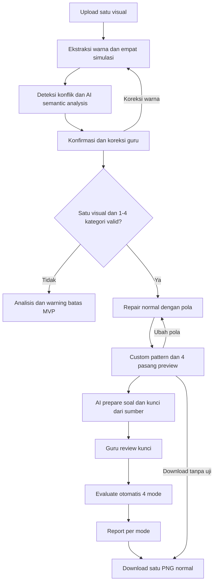
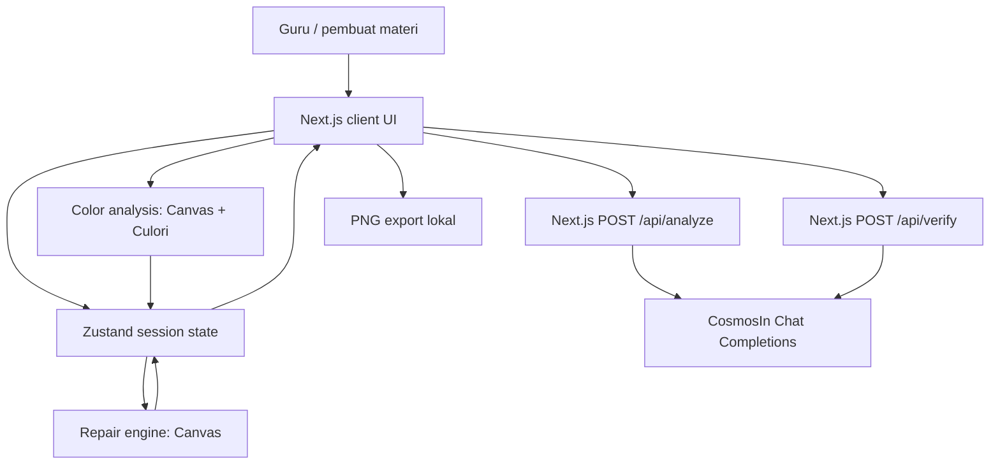

# WarnaAjar — Product Requirements Document (PRD)

> **Status:** Final MVP Scope v1.1 — revisi requirement untuk sinkronisasi tim; bukan klaim implementasi selesai  
> **Versi:** 1.1 — 27 November 2026  
> **Produk:** WarnaAjar  
> **Kategori:** Website · Quality Education (SDG 4)  
> **Target internal pengumpulan:** malam 29 November 2026  
> **Sumber:** dokumen tim *WarnaAjar — Konsep Lengkap* (26 November 2026) dan kesepakatan pembagian modul serta tech stack setelah diskusi.

**Ringkasan revisi v1.1:** satu visual dan maksimal empat kategori informasi, empat mode simulasi/uji otomatis, satu output PNG normal dengan pola, evaluasi per mode, serta konfigurasi CosmosIn aktual. FR ID dan bentuk API/shared types inti tetap. Revisi ini perlu disinkronkan ke repo dan diuji.

---

## 1. Aturan utama untuk AI coding agent

Dokumen ini adalah batas scope pengembangan MVP. Baca seluruh PRD sebelum mengubah kode. Jika tersedia, baca juga `AGENTS.md`, kontrak tipe data, dan implementasi yang relevan. Jangan memperluas scope hanya karena sebuah fitur terlihat menarik atau lazim pada aplikasi lain.

1. Kerjakan hanya modul, task, dan acceptance criteria yang diminta. Jangan mengerjakan seluruh PRD sekaligus kecuali diminta secara eksplisit.
2. Pilih perubahan terkecil yang menyelesaikan kebutuhan secara utuh. Utamakan fungsi sederhana, TypeScript yang jelas, dan reuse kode yang sudah ada.
3. Jangan membuat backend terpisah, database, login, microservices, framework tambahan, abstraksi generik, repository pattern, atau dependency injection container tanpa kebutuhan yang disetujui tim.
4. Jangan menambahkan library baru jika kemampuan yang dibutuhkan sudah tersedia di stack atau browser. Dependency baru di luar stack harus mendapat persetujuan.
5. Jangan mengubah kontrak API, shared types, struktur direktori bersama, atau modul anggota lain tanpa koordinasi. Jangan melakukan refactor di luar task.
6. Jangan menggunakan `any`, mengabaikan validasi input, memalsukan hasil AI, atau menggunakan data dummy sebagai hasil analisis produksi. Fixture hanya untuk contoh dan pengujian yang diberi label.
7. Jangan menambah fitur P1 sebelum P0 pada alur utama selesai dan tim menyetujuinya. Fitur di luar scope tidak boleh dibuat.
8. Jika ada ambiguitas yang memengaruhi perilaku lintas modul, jelaskan asumsi dan minta keputusan tim sebelum mengubah kontrak. Untuk detail lokal yang tidak berdampak pada kontrak, gunakan solusi paling sederhana.
9. Tambahkan atau sesuaikan pengujian untuk perilaku yang diubah. Jalankan pemeriksaan typecheck, lint, dan test yang relevan; laporkan bila tidak dapat dijalankan. Sebelum integrasi akhir, jalankan build dan E2E.
10. Jangan commit, push, merge, deploy, atau mengubah secret tanpa instruksi eksplisit dari pemilik task.
11. Pada akhir task, laporkan perubahan, file yang disentuh, pengujian dan hasilnya, serta keterbatasan yang tersisa. Jangan mengklaim fitur selesai jika belum lolos acceptance criteria.

**Urutan keputusan:** permintaan task yang disetujui tim → PRD dan kontrak bersama → implementasi yang ada. Jika bertentangan dengan scope PRD, tandai konflik dan jangan diam-diam memperluas scope.

---

## 2. Product overview

### 2.1 Latar belakang

Materi pembelajaran seperti grafik, diagram, peta tematik, dan tabel sering menggunakan warna sebagai satu-satunya penanda kategori atau tingkatan. Siswa dengan gangguan penglihatan warna (color vision deficiency/CVD) dapat kesulitan membedakan informasi tersebut. Pembuat materi belum tentu mengetahui hambatan itu atau memiliki waktu dan keterampilan untuk memperbaiki visual secara manual.

Simulator warna hanya membantu melihat kemungkinan perubahan persepsi. WarnaAjar melanjutkan proses tersebut sampai menghasilkan gambar yang memiliki penanda nonwarna dan dapat digunakan kembali di materi pembelajaran.

### 2.2 Tujuan produk

Membantu pembuat materi menemukan potensi hambatan penglihatan warna, memahami informasi yang terdampak, menambahkan penanda visual yang konsisten, dan mengevaluasi hasil perbaikan secara transparan tanpa mengubah substansi gambar.

WarnaAjar **bukan** alat diagnosis buta warna, terapi, atau platform pembelajaran siswa. Produk tidak menjanjikan peningkatan nilai akademik atau aksesibilitas sempurna bagi semua individu.

### 2.3 Pengguna

| Pengguna | Peran |
|---|---|
| Guru, dosen, pengajar bimbel, asisten, pembuat materi | Pengguna langsung; mengunggah, memeriksa, mengonfirmasi, memperbaiki, mengunduh gambar. |
| Siswa dan mahasiswa dengan CVD | Penerima manfaat; menggunakan visual yang telah diperbaiki melalui materi yang diberikan pengajar. Tidak wajib membuka WarnaAjar. |

MVP tidak memiliki role akun, autentikasi, ataupun pengelolaan kelas.

### 2.4 Value proposition

Satu alur **Periksa → Pahami → Perbaiki → Uji** untuk mengubah visual pembelajaran yang bergantung pada warna menjadi visual dengan penanda tambahan nonwarna, siap dipakai kembali dalam slide atau modul.

---

## 3. Scope MVP

### 3.1 P0 — wajib untuk rilis

| ID | Fitur | Pemilik utama |
|---|---|---|
| FR-01 | Upload satu gambar PNG/JPG/JPEG atau tempel gambar dari clipboard | 1 + 4 |
| FR-02 | Ekstraksi warna dominan dan simulasi normal, protan, deutan, tritan, grayscale | 1 |
| FR-03 | Deteksi pasangan warna berpotensi konflik menggunakan ΔE | 1 |
| FR-04 | Manual color picker untuk koreksi deteksi warna | 1 + 4 |
| FR-05 | AI memahami jenis visual, legenda, kategori/urutan, dan potensi hambatan | 2 |
| FR-06 | Konfirmasi dan koreksi hasil pemetaan oleh pengguna | 4 + 2 |
| FR-07 | Penambahan pola kategori dan arsir bertingkat secara deterministik | 3 |
| FR-08 | Pengaturan jenis/kerapatan pola dan sinkronisasi legenda | 3 + 4 |
| FR-09 | Uji Terbaca: pertanyaan, kunci jawaban, evaluasi visual sebelum/sesudah otomatis empat mode | 2 |
| FR-10 | Perbandingan hasil asli dan hasil perbaikan, termasuk simulasi CVD | 1 + 4 |
| FR-11 | Ringkasan audit, perbaikan, serta hasil/status evaluasi empat mode | 4 + 1 + 2 + 3 |
| FR-12 | Download PNG hasil perbaikan | 3 + 4 |
| FR-13 | Beranda, contoh siap pakai, panduan dan batasan produk | 4 |

### 3.2 P1 — tambahan hanya jika P0 selesai dan disetujui

- Penggantian palet warna alternatif atau kombinasi palet dan pola.
- Penambahan label langsung otomatis (bila makna dan lokasi dapat dipastikan).
- Upload PDF, pilih halaman, dan crop satu visual untuk diproses oleh pipeline yang sama.
- Export laporan atau gambar ke PDF. P0 cukup ringkasan di layar dan export PNG.

### 3.3 Di luar scope

- Upload dan perbaikan seluruh modul PDF/PPT/DOCX secara otomatis, batch processing, OCR dokumen penuh, serta segmentasi multi-chart atau perbaikan visual dengan lebih dari empat kategori informasi.
- Login, user profile, database, histori lintas sesi, penyimpanan cloud, role guru/siswa, dashboard kelas.
- Chatbot, RAG, vector database, rekomendasi materi belajar, kuis siswa, LMS, portal sekolah.
- Diagnosis atau skrining buta warna, profil kesehatan, simulasi klinis, eye tracking, AR, Chrome extension, aplikasi mobile native.
- AI image generation, rekonstruksi grafik dari tebakan AI, pengubahan angka/nilai/proporsi/bentuk wilayah asli.
- Foto, gradien/heatmap kontinu, ilustrasi kompleks dengan bayangan atau tekstur, video, live camera.
- Editor desain umum seperti Canva, seleksi objek kompleks, fitur kolaborasi, pembayaran, analitik bisnis.
- Pelatihan model ML sendiri atau layanan Python/OpenCV terpisah.

### 3.4 Batas input dan dukungan visual

Satu gambar raster per sesi analisis. MVP mendukung satu visual per gambar, dengan 1–4 kategori informasi yang dipetakan berdasarkan warna; swatch teks, latar, grid dan dekorasi tidak dihitung sebagai kategori. Jika lebih dari empat kategori informasi atau terdapat beberapa visual, tetap izinkan analisis warna dan simulasi, tetapi blok repair otomatis dan jelaskan batasan. Jangan mengecualikan kategori informasi yang sebenarnya relevan hanya untuk melewati batas. Tidak ada recoloring P0: ΔE mengukur perbedaan warna, simulasi hanya preview/uji, pola menambah penanda nonwarna pada satu hasil universal. Jenis visual yang ditargetkan: diagram batang, diagram lingkaran, diagram garis, peta tematik, dan tabel berwarna dengan kategori warna datar yang dapat dipisahkan. Gambar harus memiliki resolusi cukup dan makna warna yang dapat dibaca atau dikonfirmasi pengguna.

Dukungan diagram garis dibatasi pada garis yang cukup tebal/terpisah sehingga pola dapat diterapkan tanpa merusak informasi. Bila suatu visual terlalu tipis, kecil, ambigu, atau kompleks, tampilkan keterbatasan dan jangan memaksakan perbaikan. Tidak ada klaim dukungan semua variasi chart.

Warna yang merupakan objek pembelajaran itu sendiri (misalnya warna indikator kimia, spektrum warna) tidak boleh diubah maknanya. Tandai jika penambahan pola tidak sesuai atau justru merusak tujuan materi.

---

## 4. User journey

1. Guru menyiapkan slide geografi yang mengandung peta kepadatan penduduk.
2. Guru membuka WarnaAjar tanpa login, lalu mengunggah gambar peta lengkap dengan legenda (atau menempel screenshot).
3. **Periksa:** sistem mengekstrak warna dan otomatis menyiapkan simulasi protan, deutan, tritan, grayscale serta deteksi konflik. Guru tidak memilih tipe CVD siswa.
4. **Pahami:** AI mengidentifikasi makna warna (misalnya hijau = rendah, kuning = sedang, merah = tinggi), jenis data, dan menjelaskan potensi masalah.
5. Guru mengonfirmasi atau mengoreksi kategori dan urutan. Jika perlu, gunakan color picker. Validasi satu visual dan 1–4 kategori informasi sebelum repair; jika tidak memenuhi, tampilkan batasan dan hasil analisis saja.
6. **Perbaiki:** sistem menghasilkan penanda arsir yang semakin rapat untuk tingkat yang semakin tinggi. Legenda mengikuti penanda yang sama. Guru dapat menyesuaikan pola dan melihat preview.
7. Sistem menghasilkan satu gambar repair normal dan menyiapkan empat pasang preview before/after. Guru dapat memilih mode preview tanpa mengubah target repair.
8. **Uji:** AI menyiapkan 2–3 soal dan kunci dari sumber normal; guru meninjau kunci. Saat Uji Terbaca dijalankan, sistem otomatis menguji empat mode dengan pertanyaan identik. Guru/siswa tidak mengerjakan soal.
9. Accessibility Report menampilkan konflik awal, cakupan pola, warning, dan hasil/status masing-masing mode.
10. Guru mengunduh satu PNG repair normal; download valid tetap tersedia jika evaluasi dilewati/gagal.

Siswa memakai materi hasil perbaikan tanpa harus membuka aplikasi.

### 4.1 Alur sistem



---

## 5. Functional requirements dan acceptance criteria

### FR-01 — Image Input

- File picker, drag-and-drop, paste clipboard, dan contoh gambar lokal.
- Terima PNG/JPEG yang valid dan dapat didekode, bukan hanya berdasarkan ekstensi.
- Satu gambar aktif; penggantian gambar mereset hasil turunan sesi sebelumnya.
- Simpan gambar sumber tanpa modifikasi untuk perbandingan dan perbaikan ulang.
- Batasi ukuran dan resolusi dengan pesan kesalahan yang jelas. Baseline awal yang diusulkan: 5 MB file input dan maksimum 4096 px pada sisi terpanjang untuk PNG output; sepakati batas final lintas modul. Buat salinan yang diperkecil khusus analisis AI jika perlu; jangan diam-diam menurunkan resolusi export.

**Acceptance:** gambar valid dapat dipratinjau; input rusak/format tak didukung ditolak tanpa crash; penggantian input tidak menampilkan hasil dari gambar lama.

### FR-02 — Color Extraction & CVD Simulation

- Gunakan Canvas API untuk membaca piksel (RGBA) dan menghasilkan salinan visual.
- Kelompokkan warna dominan dengan color quantization (Median Cut sebagai baseline). Gunakan sampel/resolusi analisis yang masuk akal; tidak perlu pipeline ML.
- Gunakan model Machado untuk protan, deutan, dan tritan; implementasikan dengan domain warna/konversi yang sesuai referensi model. Grayscale merupakan mode tambahan, bukan simulasi klinis akromatopsia.
- MVP memakai simulasi tingkat maksimum sebagai pendekatan konservatif; jelaskan tingkat persepsi individu dapat berbeda.
- Keempat mode uji adalah `protan`, `deutan`, `tritan`, `grayscale` (grayscale adalah pengujian tambahan tanpa warna, bukan diagnosis). Guru tidak memilih jenis CVD siswa; pemilih mode hanya mengubah preview. Sistem menyiapkan empat simulasi sumber dan empat simulasi repair dari satu hasil repair normal; boleh menghasilkan secara bertahap sesuai kebutuhan memori, tanpa mengubah cakupan empat mode. Pengguna dapat berpindah antara Normal / Protan / Deutan / Tritan / Hitam-putih untuk preview.

**Acceptance:** warna sumber tidak berubah; mode berbeda menghasilkan hasil yang sesuai fixture referensi; dimensi dan alpha dipertahankan pada output simulasi; tidak ada klaim hasil sebagai persepsi aktual setiap individu.

### FR-03 — Color Conflict Detection

- Konversi warna hasil simulasi ke ruang warna yang sesuai untuk CIEDE2000 (Lab dengan white point konsisten).
- Hitung ΔE00 untuk pasangan warna unik pada setiap mode CVD. Jangan menghitung pasangan yang sama dua kali.
- Tampilkan pasangan warna sumber, mode CVD terkait, ΔE00, dan status potensi konflik.
- Gunakan satu nilai ambang yang terdokumentasi dan dapat dikonfigurasi secara internal; nilainya harus ditentukan melalui fixture/POC tim. Tidak ada ambang universal yang membuktikan dua warna tidak dapat dibedakan oleh semua orang.
- Temuan tahap ini berbasis piksel; AI dan konfirmasi pengguna menentukan apakah pasangan membawa informasi penting.

**Acceptance:** pasangan identik memiliki ΔE mendekati nol; uji nilai terhadap pasangan Lab referensi CIEDE2000; daftar konflik konsisten untuk input dan konfigurasi yang sama; UI menyebutnya potensi hambatan, bukan diagnosis.

### FR-04 — Manual Color Picker

- Guru dapat mengklik piksel pada gambar asli untuk menambahkan/mengoreksi warna target.
- Tampilkan swatch dan hex; perhitungkan scaling gambar dan koordinat Canvas.
- Jangan menambahkan mask seluruh objek secara otomatis hanya berdasarkan koordinat. Warna terpilih merupakan input segmentasi dengan toleransi yang ditetapkan engine.
- Perubahan daftar warna membatalkan hasil konflik/pemetaan/perbaikan yang bergantung padanya sampai dihitung ulang atau dikonfirmasi kembali.

**Acceptance:** klik swatch fixture menghasilkan warna yang tepat; pilihan dapat digunakan oleh modul analisis dan perbaikan; hasil lama tidak dianggap valid setelah perubahan.

### FR-05 — AI Semantic Analysis

- Endpoint server menerima gambar dan hasil analisis warna yang relevan.
- Model multimodal melalui CosmosIn mengidentifikasi jenis visual, legenda, makna warna, jenis data (categorical/ordinal/unknown), urutan jika terlihat, serta penjelasan konflik dalam bahasa Indonesia yang mudah dipahami.
- Warna yang dipetakan merujuk pada ID warna yang diberikan, bukan nilai warna baru yang ditebak oleh model.
- AI boleh menyarankan jenis penanda, tetapi tidak memodifikasi piksel atau menjadi sumber angka ΔE.
- Bila legenda tidak jelas, tandai ketidakpastian dan minta pengguna mengoreksi. Jangan mengarang kategori, nilai data atau urutan.
- Gunakan structured JSON dan Zod. Validasi referensi ID, bukan hanya struktur JSON.

**Acceptance:** response valid sesuai kontrak; ID yang tidak ada ditolak; kegagalan model, timeout, atau respons invalid tidak menyebabkan aplikasi crash; pengguna dapat mencoba lagi tanpa kehilangan input. Jika belum ada kategori yang valid, jangan lanjut otomatis ke perbaikan.

### FR-06 — User Confirmation

- Tampilkan swatch, nama kategori, pilihan sertakan/kecualikan dari perbaikan, dan urutan jika data ordinal.
- Guru dapat mengoreksi label dan urutan serta menentukan apakah hasil pemetaan benar.
- Warna dekoratif, latar belakang, teks, dan elemen yang tidak membawa kategori harus dapat dikecualikan.
- Perbaikan hanya berjalan menggunakan pemetaan yang dikonfirmasi; jangan menambahkan pola pada semua warna dominan secara buta.
- MVP mendukung satu visual per gambar, dengan 1–4 kategori informasi yang dipetakan berdasarkan warna; swatch teks, latar, grid dan dekorasi tidak dihitung sebagai kategori. Jika lebih dari empat kategori informasi atau terdapat beberapa visual, tetap izinkan analisis warna dan simulasi, tetapi blok repair otomatis dan jelaskan batasan. Jangan mengecualikan kategori informasi yang sebenarnya relevan hanya untuk melewati batas.

**Acceptance:** perubahan label/urutan disimpan dalam state sesi dan diteruskan ke engine; mapping ambigu tidak boleh diam-diam diperlakukan benar; data ordinal tanpa urutan yang valid belum dapat diproses sebagai ordinal.

### FR-07 — Automatic Image Repair

- Lakukan color masking/thresholding menggunakan warna yang sudah dikonfirmasi. Gunakan connected components jika benar-benar diperlukan untuk mencegah area salah sasaran.
- Data categorical: 1–4 kategori, gunakan jenis pola yang berbeda untuk setiap kategori (`diagonal`, `dots`, `horizontal`, `crosshatch`). Jangan menggunakan ulang jenis pola untuk kategori berbeda. Blok repair otomatis bila lebih dari empat kategori informasi.
- Data ordinal: gunakan satu keluarga arsir dengan kerapatan meningkat sesuai urutan yang dikonfirmasi.
- Pertahankan warna sumber, geometri, posisi, angka, dan teks; tambahkan pola sebagai layer/mask, bukan menggambar ulang seluruh visual.
- Terapkan pola pada kategori dan legenda secara konsisten; lindungi piksel teks, garis batas dan area bukan target. Jika pemisahan tidak aman (misalnya warna teks sama dengan fill), jangan mengklaim hasil sempurna; tampilkan preview/peringatan dan izinkan koreksi pilihan warna atau batalkan.
- Jangan memakai AI image generation. Re-render harus selalu berangkat dari gambar asli sehingga perubahan pola tidak menumpuk.

**Acceptance:** fixture warna datar memiliki pola yang sesuai di area target dan legenda; piksel di luar mask yang disetujui tidak berubah; dimensi sumber tetap; konfigurasi sama menghasilkan output konsisten; area terlalu kecil atau ambigu diberi peringatan.

### FR-08 — Custom Pattern Editor

- Pengguna dapat mengganti jenis pola dan jarak/kerapatan secara sederhana. Untuk 1–4 kategori, guru bebas memilih dari empat pola; tidak harus menggunakan semuanya. Untuk categorical, cegah konfigurasi final dengan jenis pola duplikat; ordinal menggunakan satu keluarga pola dan kerapatan sesuai urutan.
- Perubahan diterapkan pada gambar dan legenda; gunakan properti pola yang sama untuk satu kategori.
- Cegah konfigurasi final dengan jenis pola sama pada kategori categorical; tampilkan warning yang dapat diperbaiki guru. Pada ordinal jaga urutan kerapatan.
- Berikan reset ke rekomendasi awal. Tidak perlu drag-and-drop layer atau drawing editor.

**Acceptance:** mengganti pola memperbarui preview tanpa mengubah gambar asli; legenda mengikuti konfigurasi; reset memulihkan konfigurasi awal; perubahan pola membatalkan hasil Uji Terbaca sebelumnya.

### FR-09 — Uji Terbaca

- AI membuat 2–3 pertanyaan terkait informasi yang benar-benar bergantung pada warna/legenda dari gambar asli, beserta kunci jawaban. Jangan membuat pertanyaan yang membutuhkan pengetahuan di luar visual.
- Kunci berasal dari gambar asli/mapping terkonfirmasi; pengguna dapat meninjau kebenaran kunci. Jika kunci tidak dapat dipastikan, tandai hasil sebagai belum valid.
- Siapkan satu set 2–3 pertanyaan dari sumber normal dan mapping terkonfirmasi. Guru meninjau/mengoreksi pertanyaan dan kunci sebelum uji. Ketika guru menjalankan Uji Terbaca, sistem otomatis mengevaluasi keempat mode (`protan`, `deutan`, `tritan`, `grayscale`) menggunakan set yang sama, termasuk ketika tidak ada konflik terdeteksi. Before dan after pada setiap mode memakai simulasi identik dan skala sebanding. Tidak perlu memilih target CVD. Uji bersifat opsional untuk download, tetapi dukungan seluruh mode wajib tersedia pada MVP.
- Satu E2E lengkap yang berhasil tanpa retry memakai 10 panggilan AI: 1 analyze + 1 prepare + 8 penjawaban (2 per mode). Orkestrasi empat evaluate di client, satu mode per request, disarankan berurutan untuk mengurangi risiko rate limit. Setiap mode punya status pending/running/success/error dan hasil sendiri. Retry eksplisit hanya pada mode gagal; keberhasilan mode lain tidak dihapus. Jangan tampilkan kegagalan sebagai skor nol. Jika sumber/mapping/pola/kunci berubah, abaikan/batalkan hasil kedaluwarsa.
- Pisahkan pembuatan kunci dari panggilan penjawaban; jangan sertakan kunci, mapping internal atau jawaban sebelumnya pada prompt penjawaban. Jangan memberi informasi tambahan dari luar gambar yang sedang diuji. Bandingkan jawaban terhadap kunci di server dengan normalisasi sederhana (Unicode, whitespace, kapitalisasi; pertahankan angka, satuan, dan operator bermakna). Exact match setelah normalisasi = correct; jawaban berbeda = incorrect; null/tidak dapat ditentukan = uncertain. Tidak ada panggilan AI penilai tambahan; keterbatasan sinonim dicatat.
- Tampilkan jawaban, status benar/salah/tidak dapat ditentukan, jumlah benar dari jumlah pertanyaan yang valid, mode simulasi dan keterbatasan.
- Tidak ada target peningkatan wajib pada setiap gambar. Hasil yang tidak membaik tetap harus ditampilkan. Uji Terbaca merupakan heuristik AI, bukan hasil pengujian terhadap siswa CVD.

**Acceptance:** pertanyaan dan mode identik pada dua versi; kunci tidak dikirim ke penjawab; jumlah benar dihitung dari hasil nyata; respons gagal atau tidak pasti tidak dihitung benar; perubahan gambar/pola membuat hasil uji lama kedaluwarsa.

### FR-10 — Before/After Comparison

- Perbandingan visual asli dan perbaikan dengan side-by-side atau slider.
- Sediakan mode Normal/Protan/Deutan/Tritan/Grayscale pada kedua gambar dengan mode yang sama. Keempat mode uji adalah `protan`, `deutan`, `tritan`, `grayscale` (grayscale adalah pengujian tambahan tanpa warna, bukan diagnosis). Guru tidak memilih jenis CVD siswa; pemilih mode hanya mengubah preview. Sistem menyiapkan empat simulasi sumber dan empat simulasi repair dari satu hasil repair normal; boleh menghasilkan secara bertahap sesuai kebutuhan memori, tanpa mengubah cakupan empat mode.
- Label jelas mengenai versi gambar dan mode simulasi; akses keyboard tersedia.

**Acceptance:** perbandingan memakai versi sumber dan hasil terbaru dengan mode identik; slider atau tombol dapat digunakan dengan keyboard; perbandingan tidak mengganti gambar sumber.

### FR-11 — Accessibility Report (on-screen)

- Ringkas mode CVD yang memiliki potensi konflik, pasangan warna, jumlah kategori dengan pola, kategori/area yang belum ditangani, serta hasil Uji Terbaca untuk masing-masing empat mode. Tampilkan status pending/running/success/error per mode; hasil mode sukses tetap tersedia bila mode lain gagal.
- Bedakan konflik warna mentah dari konflik yang **telah diberikan penanda tambahan**. Penambahan pola tidak otomatis menghilangkan kemiripan warna/ΔE.
- Jangan menghasilkan satu skor aksesibilitas absolut yang tidak memiliki definisi; jangan menampilkan angka simulasi sebagai hasil nyata. Status perbaikan hanya berdasarkan kondisi yang benar-benar diperiksa sistem.

**Acceptance:** ringkasan menggunakan data sesi terbaru; jika belum diuji tampilkan status belum diuji, bukan 0 atau 100% palsu; jika tidak ada perubahan warna maka metrik ΔE tidak diklaim meningkat hanya karena pola ditambahkan.

### FR-12 — Export PNG

- Unduh gambar hasil perbaikan mode normal dengan warna asli + pola. Mode simulasi hanya untuk preview/uji, bukan output default.
- Nama file yang mudah dikenali, misalnya `peta-warnaajar.png`.
- Output dari Canvas dengan dimensi sumber yang diterima, tanpa watermark, layout UI, atau panel laporan.
- Pengguna dapat mengunduh hasil meski Uji Terbaca gagal dijalankan, dengan status bahwa hasil belum diverifikasi oleh AI; jangan menandainya lulus.

**Acceptance:** file PNG valid dapat dibuka dan digunakan dalam slide; legenda, pola, dan gambar sesuai preview normal; gambar asli tetap tersedia; kegagalan export menampilkan pesan.

### FR-13 — Landing, Examples & Guide

- Beranda menampilkan penjelasan singkat, contoh sebelum/sesudah, dan CTA Coba Sekarang.
- Contoh gambar buatan tim siap digunakan melalui pipeline asli, bukan jalur hasil palsu.
- Panduan singkat CVD, pola sebagai penanda tambahan, jenis visual yang didukung, dan keterbatasan.

**Acceptance:** pengguna dapat memulai alur utama tanpa akun, memilih contoh dan menyelesaikan pipeline yang sama seperti upload sendiri; klaim dan contoh sesuai batasan produk.

---

## 6. UI/UX dan navigasi

Gunakan wizard atau panel berurutan sederhana. Tidak perlu dashboard administrasi. Rute dan pembagian komponen dapat mengikuti implementasi tim; tidak wajib membuat satu route per tahap.

| Tampilan | Isi minimum |
|---|---|
| Beranda | Value proposition, contoh before/after, CTA. |
| Periksa | Input, preview, pemilih simulasi, daftar konflik, color picker. |
| Pahami | Analisis AI, makna warna, penjelasan, form konfirmasi. |
| Perbaiki | Preview gambar, pengaturan pola, perbandingan. |
| Uji & Hasil | Pertanyaan dan jawaban, ringkasan, download PNG. |
| Panduan | Cara pakai dan batasan. |

Semua tahap wajib memiliki state loading, error, empty/unsupported, dan success yang relevan. Jangan menggunakan warna saja untuk status: sertakan ikon dan teks. Kontrol utama bisa dioperasikan dengan keyboard, punya accessible name dan focus indicator. Teks normal menargetkan kontras WCAG AA (4.5:1; teks besar 3:1). Gunakan responsivitas yang wajar; tidak perlu desain mobile native.

---

## 7. Tech stack yang disepakati

| Kategori | Stack |
|---|---|
| Full-stack | Next.js (App Router), React, TypeScript |
| UI | Tailwind CSS, shadcn/ui, Lucide React |
| Image processing | Canvas API (ImageData, CanvasPattern, export PNG) |
| Color processing | Culori (konversi warna/ΔE sesuai API versi yang dipakai) |
| State | Zustand (state sesi minimal, tanpa persist) |
| AI | CosmosIn (OpenAI-compatible), SDK `openai` |
| Validation | Zod |
| Testing | Vitest (unit), Playwright (E2E) |
| Deployment | Vercel |
| Version control | Git & GitHub, satu repository publik untuk lomba |

CosmosIn melalui SDK `openai` (Chat Completions OpenAI-compatible), model `deepseek-v4.1-flash` melalui env server `COSMOS_MODEL`, `COSMOS_BASE_URL=https://api.cosmosin.io/v1`, dan `COSMOS_API_KEY`. Strict JSON Schema + validasi Zod runtime; non-streaming, retry otomatis 0, timeout 45.000 ms per panggilan, max output 2048 token. Tidak ada fallback model/provider. POC kemampuan berhasil; live route analyze masih perlu debugging (HTTP 502 AI_INVALID_RESPONSE pada smoke awal). Batas AI: 1.5 MiB (1.572.864 byte) per gambar, 3.5 MiB (3.670.016 byte) total body multipart aktual, 64 KiB (65.536 byte) total field teks/metadata UTF-8. Ini bukan batas gambar sumber/export. Client menyiapkan salinan AI dengan legenda/pola tetap terbaca; server membatasi stream aktual dan memeriksa MIME/signature, bukan decode penuh. Jangan memasukkan key ke `NEXT_PUBLIC_*`, bundle browser atau repo.

Tidak ada database, Redis, storage eksternal, service backend terpisah, atau Docker wajib.

### 7.1 Arsitektur



- Client: decode gambar, simulasi, ΔE, segmentasi, pemberian pola, preview, export.
- Server: validasi request, panggil CosmosIn, validasi/normalisasi response. Tidak menyimpan file secara permanen.
- Gambar yang diperlukan AI dikirim melalui server ke penyedia AI. Klaim seluruh proses lokal tidak benar; jelaskan ini pada UI sebelum analisis AI.

---

## 8. Kontrak antarmodul (baseline integrasi)

Kontrak berikut adalah baseline teknis v1.1; rincian HTTP dan aturan integrasi mengikuti CONTRACTS.md. Shared types inti dipertahankan. Gunakan sumber tipe bersama yang sudah ada: `src/types/index.ts`. Nama internal boleh mengikuti repo yang sudah ada; jangan membuat tipe duplikat per modul. Perubahan kontrak harus diketahui anggota yang terdampak.

### 8.1 Shared types minimum

```ts
export type CvdMode = 'normal' | 'protan' | 'deutan' | 'tritan' | 'grayscale';
export type SimulatedMode = Exclude<CvdMode, 'normal'>;
export type VisualType = 'bar' | 'pie' | 'line' | 'map' | 'table' | 'unknown';
export type DataType = 'categorical' | 'ordinal' | 'unknown';
export type PatternKind = 'diagonal' | 'dots' | 'horizontal' | 'crosshatch';

export interface ColorSwatch {
  id: string;
  hex: string; // #RRGGBB
}

export interface ColorConflict {
  colorAId: string;
  colorBId: string;
  mode: SimulatedMode;
  deltaE: number;
}

export interface ColorAnalysisResult {
  colors: ColorSwatch[];
  conflicts: ColorConflict[];
  threshold: number;
}

export interface SemanticCategory {
  colorId: string;
  label: string | null;
  included: boolean;
  order: number | null; // only for confirmed ordinal data
  suggestedPattern?: PatternKind;
}

export interface SemanticAnalysis {
  visualType: VisualType;
  dataType: DataType;
  categories: SemanticCategory[];
  explanation: string;
  warnings: string[];
}

export interface PatternConfig {
  colorId: string;
  kind: PatternKind;
  spacingPx: number;
}

export interface RepairResult {
  image: ImageData; // client only; not serialized to API
  appliedColorIds: string[]; // means pattern applied, not certified readable
  warnings: string[];
}

export interface VerificationQuestion {
  id: string;
  question: string;
  expectedAnswer: string;
}

export type AnswerStatus = 'correct' | 'incorrect' | 'uncertain';
export interface VerifiedAnswer {
  answer: string | null;
  status: AnswerStatus;
}
export interface VerificationItem {
  question: VerificationQuestion;
  before: VerifiedAnswer;
  after: VerifiedAnswer;
}
export interface VerificationResult {
  mode: SimulatedMode;
  items: VerificationItem[];
  warnings: string[];
}
```

Anggota 1 menyediakan `ColorAnalysisResult` dan fungsi simulasi yang dapat dipakai oleh anggota 4 untuk preview dan Uji Terbaca. Anggota 2 menyediakan hasil semantic dan verification yang valid. Anggota 3 menerima gambar asli, daftar warna, kategori terkonfirmasi, jenis data, dan konfigurasi pola; mengembalikan `RepairResult`. Anggota 4 menghubungkan seluruh state sesi dan flow. `ImageData` hanya digunakan pada browser; gunakan Blob/File dan URL object untuk preview jika diperlukan, bukan base64 permanen di state.

### 8.2 API routes

Gunakan dua endpoint inti, `multipart/form-data` untuk gambar dan metadata JSON, serta response JSON. Ukuran request total harus berada di bawah limit hosting yang berlaku; buat salinan AI lebih kecil dari gambar export. Jangan menambah endpoint CRUD, upload storage, atau endpoint yang tidak dibutuhkan.

| Endpoint | Request minimum | Response |
|---|---|---|
| `POST /api/analyze` | `image`: Blob/File; `analysis`: JSON `ColorAnalysisResult`; konteks pelajaran opsional | `SemanticAnalysis` |
| `POST /api/verify` | `action=prepare`: gambar asli + mapping terkonfirmasi; `action=evaluate`: gambar before & after yang sudah disimulasikan, mode, pertanyaan dan kunci terkonfirmasi | `prepare`: daftar pertanyaan/kunci; `evaluate`: `VerificationResult` |

Pemisahan prepare/evaluate di satu route memungkinkan kunci ditinjau sebelum uji. Pada evaluate, server menerima kunci untuk evaluasi tetapi **tidak memasukkan kunci pada panggilan model penjawab**. Untuk evaluasi, before dan after dijawab secara terpisah dengan pertanyaan identik. Tidak ada session storage server; klien membawa data yang dibutuhkan setiap request.

Field HTTP persis mengikuti `CONTRACTS.md`; evaluate tetap satu mode per request. Satu E2E lengkap yang berhasil tanpa retry memakai 10 panggilan AI: 1 analyze + 1 prepare + 8 penjawaban (2 per mode). Orkestrasi empat evaluate di client, satu mode per request, disarankan berurutan untuk mengurangi risiko rate limit. Setiap mode punya status pending/running/success/error dan hasil sendiri. Retry eksplisit hanya pada mode gagal; keberhasilan mode lain tidak dihapus. Jangan tampilkan kegagalan sebagai skor nol. Jika sumber/mapping/pola/kunci berubah, abaikan/batalkan hasil kedaluwarsa.

Error minimal:

```json
{
  "error": {
    "code": "INVALID_INPUT",
    "message": "Gambar atau metadata tidak valid."
  }
}
```

Gunakan status HTTP yang sesuai untuk input salah, terlalu besar, limit, kegagalan penyedia, atau timeout. Jangan memaparkan secret atau detail internal. UI dapat melakukan retry eksplisit.

### 8.3 State dan invalidation

- `sourceImage` → `colorAnalysis` → `semanticAnalysis` → `confirmedMapping` → `patterns` / `repairResult` → `verificationResults`.
- Ganti gambar: reset semua hasil turunan.
- Ubah warna: hitung ulang color conflicts; invalidasi semantic/mapping, pola, repair, pertanyaan/kunci dan seluruh hasil verification.
- Ubah mapping: invalidasi pola, repair, pertanyaan/kunci dan seluruh hasil verification; gunakan hasil color analysis yang sama jika swatch tidak berubah.
- Ubah pola: invalidasi repair dan seluruh hasil/status verification; hitung ulang repair dari sumber asli. Pertanyaan/kunci tetap jika sumber dan mapping tidak berubah.
- `verificationResults: Partial<Record<SimulatedMode, VerificationResult>>` pada state client, plus status/error per mode. Ubah kunci/pertanyaan: reset seluruh hasil dan review ulang. Ubah mode preview tidak membatalkan hasil uji; mode uji otomatis empat mode.
- Abaikan respons async yang berasal dari gambar atau revisi state yang sudah tidak aktif. Tidak perlu event bus atau state machine library.

---

## 9. Pembagian modul dan ownership

| Anggota | Ownership | Deliverable |
|---|---|---|
| Orang 1 | Image Processing & Color Analysis (FR-01 bagian decode, FR-02–04, fungsi simulasi bersama) | Fungsi ekstraksi warna, simulasi, deteksi konflik, picker helper, unit test. |
| Orang 2 | AI Semantic Analysis & Verification (FR-05, FR-09) | Dua API route, CosmosIn integration, Zod schema, prompt dan fixture test, error handling. |
| Orang 3 | Image Repair & Pattern Engine (FR-07–08, FR-12) | Color masking, render pola, aturan ordinal, sinkronisasi legenda, export PNG, unit test. |
| Orang 4 | Frontend, UI/UX & System Integration (FR-01 UI, FR-06, FR-08 UI, FR-10–13) | UI wizard, state, integrasi, laporan, E2E, deployment jika diizinkan. |

Dokumentasi, proposal, video demo, dan validasi dikerjakan bersama sesuai modul. Orang 4 bukan pemilik seluruh logika algoritma; UI dan integrasi menjadi tanggung jawab utamanya.

### 9.1 Struktur folder yang disarankan

```text
warnaajar/
├── PRD.md
├── src/
│   ├── app/
│   │   └── api/
│   │       ├── analyze/route.ts
│   │       └── verify/route.ts
│   ├── components/
│   ├── modules/
│   │   ├── color-analysis/
│   │   ├── ai-analysis/
│   │   ├── image-repair/
│   │   └── verification/
│   ├── stores/
│   ├── types/
│   └── lib/
├── public/
├── tests/
├── .env.example
└── README.md
```

Gunakan struktur yang sudah ada bila sesuai. Jangan memindahkan seluruh repo hanya untuk mengikuti contoh ini. Tidak perlu layer domain/application/infrastructure terpisah atau package per modul.

### 9.2 Integrasi paralel

1. Sepakati shared types, contoh input/output JSON, dan batas input sebelum coding terpisah.
2. Masing-masing anggota membangun modul dan unit test dengan fixture yang diketahui. Frontend boleh memakai mock selama development yang ditandai jelas; mock harus dilepas dari jalur produksi.
3. Integrasikan berurutan: upload → color analysis → AI analysis → konfirmasi → repair → Uji Terbaca → export.
4. Jalankan E2E, periksa error state, aksesibilitas dasar, dan siapkan demo. Jangan mulai P1 jika alur P0 belum stabil.

---

## 10. Non-functional requirements

### 10.1 Privasi dan keamanan

- Tidak ada login, database, penyimpanan dokumen permanen atau histori lintas sesi. State sesi berada di memori browser; refresh boleh mereset data.
- Sebelum mengirim gambar ke CosmosIn, beri penjelasan yang jelas bahwa gambar dikirim ke layanan AI pihak ketiga. Jangan mengklaim kebijakan retensi penyedia tanpa memverifikasi kebijakan API yang digunakan.
- Hindari gambar berisi data pribadi siswa, informasi rahasia, atau materi tanpa izin. Jangan log isi gambar, prompt sensitif, API key, atau base64.
- Validasi MIME, decode di client, ukuran request, schema dan referensi ID di server. Perlakukan tulisan pada gambar sebagai data, bukan instruksi kepada AI.
- Batasi payload, panggilan ulang, dan kuota penyedia; request tidak boleh berjalan berulang tanpa tindakan pengguna. Gunakan pengamanan endpoint publik yang proporsional; jangan menambah infrastruktur baru hanya untuk rate limiting tanpa persetujuan.
- Secret hanya server-side; `.env.example` berisi nama variabel tanpa nilai rahasia.

### 10.2 Kinerja dan keandalan

- Satu gambar aktif; gunakan salinan resolusi rendah untuk analisis bila diperlukan.
- Hindari kalkulasi piksel mahal setiap render React. Hitung ulang hanya saat parameter berubah; debounce bila relevan.
- Tampilkan indikator proses untuk operasi yang memakan waktu. Gunakan Web Worker hanya jika profiling menunjukkan UI terblokir dan tidak dapat diselesaikan sederhana.
- Batalkan/abaikan hasil lama saat sumber berubah. Beri pesan dan pilihan retry untuk kegagalan AI; pertahankan sumber dan hasil repair yang masih valid.
- Lepaskan object URL yang tidak dipakai dan data gambar lama.
- Target kinerja kuantitatif belum divalidasi. Ukur waktu analisis lokal, repair dan AI secara terpisah dengan perangkat/ukuran gambar yang dicatat; jangan mengarang angka latency.

### 10.3 Aksesibilitas

- Navigasi keyboard, label kontrol, focus indicator, dan status tekstual, termasuk saat loading/error.
- Kontras antarmuka yang memadai; bukan hanya warna untuk menyampaikan informasi.
- Bahasa Indonesia, istilah CVD dijelaskan secara sederhana. Desain tidak mengasumsikan semua pengguna dapat membedakan swatch warna.
- Targetkan browser desktop modern (Chrome sebagai baseline demo) dan layout responsif. Jangan menjanjikan kompatibilitas semua browser tanpa pengujian.

---

## 11. Testing dan pengukuran keberhasilan

### 11.1 Unit / integration test

| Modul | Uji minimum |
|---|---|
| Color extraction | Gambar sintetis dengan warna diketahui, input transparan, warna terpilih dari koordinat. |
| CVD simulation | Fixture referensi transformasi; alpha dan dimensi tidak berubah; mode normal tidak memodifikasi data. |
| ΔE dan konflik | Nilai referensi CIEDE2000, identik mendekati nol, tanpa duplikasi pasangan, ambang konsisten. |
| Semantic AI | Schema valid/invalid, ID warna tidak dikenal, ordinal tanpa urutan, API error dan timeout. |
| Pattern engine | Mask area target, pola sinkron dengan legenda, area non-target tidak berubah, ordinal density, determinisme, reset dari sumber. |
| Verification | Pertanyaan sama untuk kedua versi, kunci tidak dikirim ke penjawab, status dan agregasi benar, error tidak dianggap lulus. |
| State | Perubahan sumber/mapping/pola mereset hasil turunan yang relevan; respons async lama diabaikan. |
| Export | PNG bisa didekode, dimensi benar, output normal, sesuai preview. |

### 11.2 E2E wajib

- Happy path: contoh/upload valid → Periksa → Pahami → konfirmasi → Perbaiki → Uji → download PNG.
- Fixture 2 dan 4 kategori: custom pattern berbeda, reset, legenda konsisten; fixture 5+ kategori dan multi-visual hanya analisis/simulasi dengan warning, repair diblok.
- Empat mode otomatis: set soal sama, hasil/status per mode, kegagalan satu mode tidak menghapus lainnya; retry hanya mode gagal; perubahan pola membatalkan seluruh hasil.
- File tidak valid ditolak tanpa crash.
- Koreksi warna dan ubah pola memperbarui hasil serta membatalkan hasil uji lama.
- Kegagalan AI menampilkan error dan retry tanpa menghapus sumber. Uji gagal tidak menghalangi download hasil repair yang valid dengan penjelasan status.
- Visual yang tidak dapat diperbaiki secara aman diberi peringatan, bukan hasil lulus palsu.
- Navigasi keyboard untuk kontrol inti.

Gunakan mock AI deterministik untuk E2E otomatis, dan lakukan smoke test terpisah dengan API asli. Jangan menjadikan hasil mock sebagai bukti kualitas CosmosIn.

### 11.3 Dataset uji dan metrik

Siapkan 15–20 visual buatan tim, mencakup diagram batang/lingkaran/garis, peta tematik, dan tabel. Sertakan visual dengan/tanpa konflik, legenda yang mudah/ambigu, area kecil, kompresi JPEG, serta contoh di luar scope. Catat ground truth warna, kategori, mask yang diharapkan, dan pertanyaan/kunci untuk fixture yang dinilai. Jangan memasukkan scan buku berhak cipta ke repo publik.

Metrik teknis: ketepatan pasangan konflik terhadap fixture, ketepatan masking, proporsi kategori dengan penanda, konsistensi legenda, perubahan piksel di luar area target, jumlah jawaban Uji Terbaca yang sesuai kunci, serta waktu pemrosesan. Laporkan definisi, sampel dan hasil nyata; tidak perlu mengejar skor 100% pada semua gambar.

Jika 2–3 relawan CVD tersedia, lakukan uji eksploratif sederhana (gambar asli vs perbaikan; jawaban dan waktu) dengan persetujuan mereka, tanpa menyimpan identitas atau mengklaim bukti klinis. Jika tidak tersedia, laporkan pengujian teknis saja. Simulasi CVD dan model visi **tidak menggantikan** pengalaman manusia.

---

## 12. Risiko dan mitigasi

| Risiko | Mitigasi MVP |
|---|---|
| Warna terkompresi/anti-aliasing | Toleransi warna, preview, color picker; hindari mengklaim segmentasi sempurna. |
| Warna latar/teks sama dengan kategori | Konfirmasi mapping, perlindungan area bila dapat dibedakan, warning bila tidak aman. |
| Legenda AI salah atau tak terlihat | Structured output, label unknown, koreksi manual. |
| Pola terlalu padat atau area terlalu kecil | Kerapatan dapat diubah, preview, warning; jangan paksa pola. |
| AI mengarang atau bias pada hasil uji | Kunci ditinjau, panggilan penjawab terpisah, tampilkan ketidakpastian. |
| API limit atau gagal | Batasi panggilan, error/retry; fungsi lokal tidak bergantung pada jaringan. |
| Scope melebar | P0 dahulu, P1 memerlukan keputusan tim; gunakan PRD pada setiap prompt agent. |
| Klaim aksesibilitas berlebihan | Jelaskan indikator teknis, bukan bukti manusia atau peningkatan nilai. |

---

## 13. Definition of Done (MVP)

MVP dianggap selesai ketika:

- [ ] Seluruh acceptance criteria P0 yang relevan dipenuhi; dukungan visual yang belum stabil dinyatakan secara eksplisit, bukan disembunyikan.
- [ ] Satu alur nyata dapat dijalankan dari upload hingga download tanpa login.
- [ ] Simulasi dan deteksi konflik bekerja dari perhitungan program, bukan hardcoded.
- [ ] AI semantic dan Uji Terbaca menggunakan API asli pada jalur produksi serta output divalidasi.
- [ ] Guru dapat mengoreksi warna/label/urutan dan pengaturan pola.
- [ ] Output mempertahankan informasi visual dalam batas dukungan yang diuji dan legenda konsisten.
- [ ] Uji Terbaca otomatis empat mode memakai pertanyaan yang sama, tidak menerima bocoran kunci pada panggilan penjawab, hasil/status per mode ditampilkan jujur; download tidak terblokir.
- [ ] Typecheck, lint, unit test, build, dan E2E relevan lulus; blocker yang belum selesai dilaporkan.
- [ ] Repo tidak memuat API key atau data pribadi; README memuat cara setup, menjalankan test, scope dan keterbatasan.
- [ ] Website dapat diakses melalui URL deployment publik setelah disetujui pemilik proyek.
- [ ] Demo dan proposal menjelaskan fungsi, hasil pengujian, dan keterbatasan tanpa klaim yang tidak dibuktikan.

---

## 14. Template prompt untuk AI agent

Gunakan template ini untuk setiap task anggota agar agent tidak keluar scope.

```text
Baca PRD.md terlebih dahulu. Jika tersedia, baca AGENTS.md dan shared types.
Kamu bertanggung jawab hanya pada modul [nama modul / anggota].

Task: [jelaskan satu kebutuhan spesifik].
Requirements: [ID FR yang relevan].
Acceptance criteria: [salin kriteria dari PRD yang terkait].
File/area yang boleh diubah: [scope direktori/file].

Pelajari implementasi yang sudah ada dan pilih perubahan terkecil yang memenuhi task.
Jangan menambah fitur, dependency, arsitektur, atau mengubah kontrak antarmodul tanpa izin.
Jangan mengerjakan P1 atau fitur di luar scope. Jangan menggunakan any, data dummy sebagai
hasil produksi, atau menyembunyikan error. Jangan commit/push/merge/deploy tanpa izin.
Tambahkan test yang relevan dan jalankan pemeriksaan yang diperlukan.
Laporkan perubahan, file, hasil test, dan keterbatasan yang tersisa.
```

Contoh task Orang 1: implementasikan FR-03 berdasarkan hasil swatch dan fungsi simulasi yang sudah tersedia; jangan membuat UI, API, atau engine repair. Contoh task Orang 3: implementasikan FR-07 dari kontrak yang sudah disepakati; jangan mengubah prompt CosmosIn atau state global.

---

## 15. Keputusan yang perlu dikunci bersama tim sebelum integrasi

Ini bukan daftar fitur tambahan. Ini adalah parameter implementasi yang belum ditentukan dalam konsep awal dan harus disepakati agar tidak ada asumsi berbeda antarmodul:

- Batas ukuran/resolusi gambar input dan salinan AI, sesuai limit hosting/provider.
- Nilai ambang ΔE, toleransi masking, jumlah swatch maksimum yang wajar, dan fixture referensi.
- Shared types inti tetap, payload mengikuti CONTRACTS v1.1; koordinasikan perubahan state per mode dan wrapper internal sebelum merge.
- Provider/model/timeout sudah ditetapkan di §7; verifikasi kuota dan live endpoint, ukur latency aktual.
- Jenis diagram datar yang lolos POC (khususnya diagram garis/area kecil) serta fallback jika tidak aman.

Bila parameter belum dikunci, anggota boleh membuat POC lokal/fixture tanpa mengubah kontrak produksi. Jangan menjadikannya alasan untuk menambah arsitektur baru.
